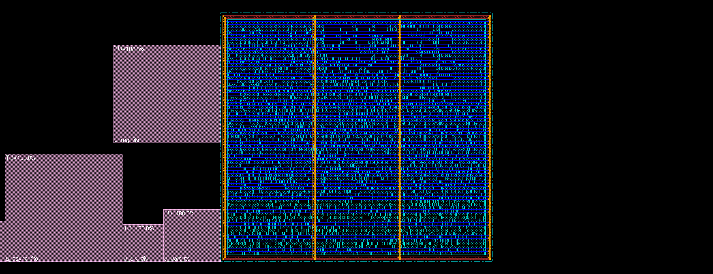
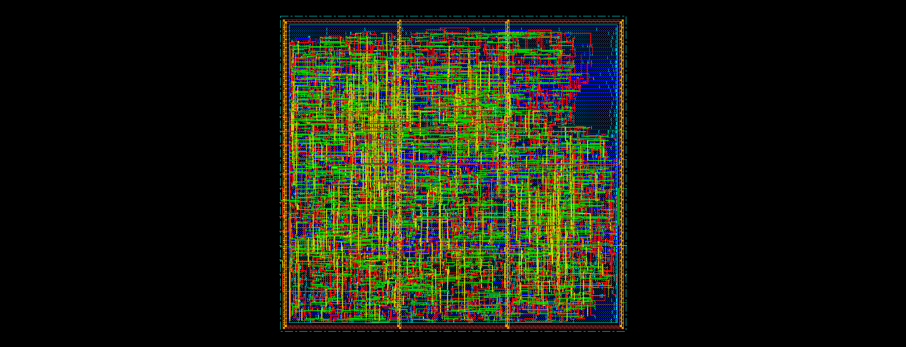
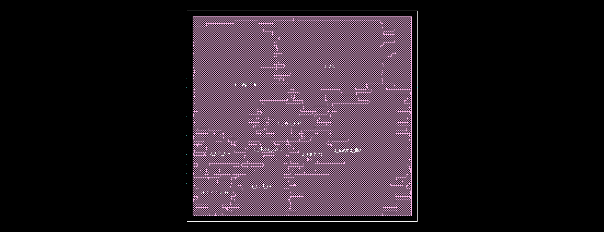
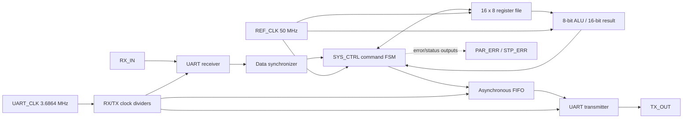
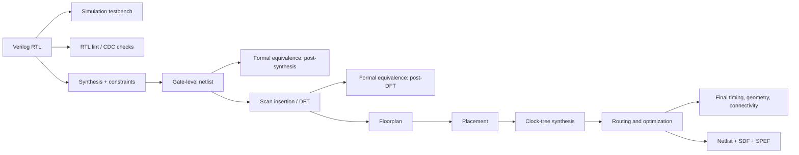

# Asynchronous UART Controller — RTL-to-PnR Project Report

## Project overview

This repository documents a complete digital-design flow for an 8-bit UART-controlled system. A serial command received on `RX_IN` can write or read the register file, launch an ALU operation, and return one or two result bytes through `TX_OUT`. The RTL uses separate system and UART clock domains, reset synchronizers, a data synchronizer, and an asynchronous FIFO between control logic and the transmitter.

The implementation flow represented here runs from Verilog RTL through simulation setup, lint, synthesis, formal equivalence, scan insertion, and place-and-route. The checked-in scripts, reports, netlists, timing/parasitic files, and screenshots are linked below so the design can be reviewed stage by stage.

> **Placement density:** the placement density before filler insertion, as provided for this run, is **67%**. Filler cells are physical-only cells inserted later to occupy suitable whitespace and support manufacturing. The final Encounter summary reports a different density metric after physical cells are present; see [Physical-design results](#physical-design-results) for the distinction.

## Visual project evidence

### Floorplan



### Standard-cell placement



### Amoeba / congestion view



These are the floorplan, placement, and amoeba-view GIFs checked into `PnR/`. The images are visual snapshots of the implementation database; the reports remain the source of numeric results.

## Contents

- [System architecture](#system-architecture)
- [UART command protocol](#uart-command-protocol)
- [Register and ALU behavior](#register-and-alu-behavior)
- [RTL module guide](#rtl-module-guide)
- [RTL-to-layout flow](#rtl-to-layout-flow)
- [Verification and lint evidence](#verification-and-lint-evidence)
- [Synthesis results and outputs](#synthesis-results-and-outputs)
- [DFT and scan outputs](#dft-and-scan-outputs)
- [Formality equivalence results](#formality-equivalence-results)
- [Physical-design results](#physical-design-results)
- [Repository output guide](#repository-output-guide)
- [Running the RTL testbench](#running-the-rtl-testbench)
- [Limitations and reproducibility notes](#limitations-and-reproducibility-notes)
- [License](#license)

## System architecture

`SYS_TOP` is the integration top. It connects the UART receiver and transmitter to a command controller, a 16-entry register file, an ALU, and a 16-word asynchronous FIFO. Received bytes cross from the UART clock domain into the reference-clock domain through a data synchronizer. Transmit bytes cross in the other direction through the asynchronous FIFO.



### Clock and reset domains

| Domain / signal | Role in the design | Configured timing |
|---|---|---:|
| `REF_CLK` | Command FSM, register file, ALU interface, FIFO write side | 50 MHz, 20 ns period |
| `UART_CLK` | UART timing source and FIFO read / transmit side | 3.6864 MHz, about 271.3 ns period |
| `alu_clk` | Clock-gated ALU clock derived from `REF_CLK` | Declared generated clock in constraints |
| `rx_clk` | Receiver sampling clock derived from UART clock and prescale setting | Prescale-dependent |
| `tx_clk` | Transmitter bit clock derived from UART clock and register 3 | Divide ratio 32 by default |
| `RST` | Active-low external reset input | Synchronized separately into both clock domains |

The synthesis constraints define asynchronous clock groups between the reference-clock group (`ref_clk`, `alu_clk`) and UART group (`uart_clk`, `rx_clk`, `tx_clk`). The CDC lint setup and asynchronous FIFO address crossings between these groups.

## UART command protocol

The controller recognizes four command bytes. UART data is transmitted least-significant bit first, with a start bit, eight data bits, optional parity, and a stop bit. The testbench sends complete frames with even parity and checks serial responses.

| Command | Following input bytes | Action | Response |
|---|---|---|---|
| `0xAA` | Register address, then write data | Write one register-file location | No data response |
| `0xBB` | Register address | Read one register-file location | One UART byte |
| `0xCC` | Operand A, operand B, ALU function | Load operands, execute ALU function | Result low byte, then high byte |
| `0xDD` | ALU function | Execute with the operand values already stored in registers 0 and 1 | Result low byte, then high byte |

The command controller waits for a complete received byte before advancing through the command states. Read data and ALU result bytes are queued into the transmit FIFO. The FIFO and transmitter handshake prevents a result byte from being consumed before the FIFO read data has settled.

### Example transactions exercised by the testbench

- **Register write/readback:** `AA 04 5A` writes `0x5A` to address 4; `BB 04` reads it back and compares the returned byte with `0x5A`.
- **ALU add:** `CC 12 03 00` adds `0x12 + 0x03`; expected 16-bit result: `0x0015`.
- **ALU multiply using saved operands:** `DD 02` multiplies the saved `0x12` and `0x03`; expected result: `0x0036`.

These are the testbench's stimulus and expected checks. The repository includes the testbench source and simulator scripts; it does not include a simulator transcript proving a run on a particular machine.

## Register and ALU behavior

### Register file

The register file is parameterized for a 4-bit address and 8-bit data width, giving 16 byte-wide locations. Four entries also drive dedicated design functions:

| Address | Reset value | Purpose |
|---:|---:|---|
| 0 | `0x00` | ALU operand A |
| 1 | `0x00` | ALU operand B |
| 2 | `0x81` | UART configuration: parity enable at bit 0, parity type at bit 1, prescale at bits 7:2 |
| 3 | `0x20` | UART transmit divider ratio; default 32 |
| 4–15 | `0x00` | General-purpose byte locations |

Writes occur on the reference-clock edge when `WrEn` is asserted. A read captures the addressed byte and pulses `RdData_Valid`.

### ALU function encoding

The ALU accepts two 8-bit operands and returns a 16-bit result. The controller sends the low result byte first, then the high byte.

| Function | Operation |
|---:|---|
| `0` | Addition |
| `1` | Subtraction |
| `2` | Multiplication |
| `3` | Division; returns zero when B is zero |
| `4` | Bitwise AND |
| `5` | Bitwise OR |
| `6` | Bitwise NAND |
| `7` | Bitwise NOR |
| `8` | Bitwise XOR |
| `9` | Bitwise XNOR |
| `A` | Equality comparison |
| `B` | Greater-than comparison |
| `C` | Logical shift A right by one |
| `D` | Logical shift A left by one |
| Other | Zero |

The datapath is in `rtl/ALU.v`; its output-valid signal lets the controller wait for the registered operation result before queuing response bytes.

## RTL module guide

| RTL file | Responsibility |
|---|---|
| [`SYS_TOP.v`](rtl/SYS_TOP.v) | Instantiates the major blocks, connects clocks/resets, UART paths, register file, ALU, and FIFO. |
| [`SYS_CTRL.v`](rtl/SYS_CTRL.v) | Decodes command bytes, sequences register writes/reads and ALU operations, and produces transmit bytes. |
| [`Reg_file.v`](rtl/Reg_file.v) | 16 × 8-bit storage with synchronous read/write controls and reset defaults. |
| [`ALU.v`](rtl/ALU.v) | Registered arithmetic and logic functions with a 16-bit result and valid flag. |
| [`Rx.v`](rtl/Rx.v) | UART receive FSM, start/data/parity/stop checks, majority-voted data sampling, and deserialization. |
| [`Tx.v`](rtl/Tx.v) | UART transmit FSM and serializer for start, data, optional parity, and stop bits. |
| [`async_fifo.v`](rtl/async_fifo.v) | Dual-clock FIFO wrapper, synchronized pointers, registered status/data outputs. |
| [`FIFO_WR.v`](rtl/FIFO_WR.v), [`FIFO_RD.v`](rtl/FIFO_RD.v) | FIFO pointer updates and full/empty detection. |
| [`fifo_mem_cntrl.v`](rtl/fifo_mem_cntrl.v) | FIFO storage write/read selection. |
| [`DF_SYNC.v`](rtl/DF_SYNC.v) | Synchronizes FIFO pointer vectors between clock domains. |
| [`synch_.v`](rtl/synch_.v) | Multi-stage data-bus synchronization and destination pulse generation. |
| [`rst_synch.v`](rtl/rst_synch.v) | Reset synchronizer used in the two clock domains. |
| [`clk_div.v`](rtl/clk_div.v) | Programmable clock division for UART timing. |
| [`clk_gating.v`](rtl/clk_gating.v) | Latch-based clock-enable gate used for the ALU clock. |
| [`PULSE_GEN.v`](rtl/PULSE_GEN.v) | Converts transmitter busy-state completion into the FIFO read increment pulse. |
| [`mux2X1.v`](rtl/mux2X1.v) | Two-input mux used in the DFT/test integration. |
| [`tb_SYS_TOP.v`](rtl/tb_SYS_TOP.v) | Simulation stimulus and self-checks for register access and ALU command flows. |

## RTL-to-layout flow

The repository is organized around the following sequence. Each stage consumes the representation from the previous stage and emits files used for review or by the next tool.



### 1. RTL and simulation setup

The synthesizable design is under `rtl/`. `rtl/tb_SYS_TOP.v` creates 50 MHz and approximately 3.686 MHz clocks, sends UART frames, receives output frames, and checks the four example command cases above. `run.do` and `rtl/run.do` are Questa/ModelSim scripts; `rtl/wave.do` configures waveform viewing.

### 2. Lint and CDC setup

- `lint/rtl/` contains the selected RTL summary `moresimple.rpt` and `waiver.rpt`.
- `lint/cdc/` contains the CDC constraints and waiver artifact.
- The RTL summary records two informational design-read messages. The waiver report documents the intentional latch in `clk_gating`, used to hold the clock enable safely during the clock phase.
- A CDC setup/waiver file is not itself proof that a CDC analysis completed cleanly. No CDC pass/fail summary is included in the repository output list.

### 3. Synthesis

The synthesis constraints describe input/generated clocks, clock uncertainty and transitions, asynchronous clock groups, I/O delays, and design checks. Synthesis maps the RTL into the standard-cell library, writes a gate-level netlist, and produces area, timing, constraint, and power reports. These files are under `syn/`.

### 4. Formal equivalence after synthesis

Formality compares the RTL reference against `syn/SYS_TOP_Netlist.v`. The checked-in compare-point reports list **302 passing points**, with no failing, aborted, or unverified compare points in the corresponding reports. The setup script and run log are kept with the reports in `Formality_post-synthesis/`.

### 5. DFT insertion

The DFT flow adds scan access and test controls to the synthesized design, producing `DFT/SYS_TOP_dft_Netlist.v`. The scan-path report lists three chains with lengths **145, 145, and 144**. DFT area, setup/hold timing, clocks, constraints, power, and DFT setup/check reports are also included.

### 6. Formal equivalence after DFT

Formality compares the functional RTL reference against the scan-inserted implementation. The reports list **303 passing points**, with no failing, aborted, or unverified compare points in the checked-in point reports. The added compare point reflects the DFT-stage implementation. See `Formality_post-dft_Stage/`.

### 7. Floorplan and placement

The Encounter scripts define a floorplan, connect power/ground, place standard cells, and run geometry checks. `PnR/floorplan.tcl` includes a floorplan dimension of 240.47 × 220.47 (with 6.0 margins as specified in the script). `PnR/placement.tcl` runs placement with in-place optimization and pre-placement optimization.

The design's placement-density figure supplied for this report is **67% before filler insertion**. Density depends on which cells and blocked regions are included and on the implementation stage; it should always be quoted with that stage/definition.

### 8. Clock-tree synthesis

`PnR/cts.tcl` generates the clock-tree specification and runs clockDesign. The CTS stage builds and balances clock distribution after placement. The Encounter command history records pre-CTS, post-CTS, and hold-oriented timing analysis steps.

### 9. Routing and physical optimization

`PnR/routing.tcl` invokes global/detail routing with via and wire optimization, including an ECO routing path. The recorded Encounter command history runs post-route timing, design-rule, geometry, and connectivity checks. The final routed database is represented by `PnR/SYS_TOP_routed.enc`.

### 10. Final implementation outputs

The repository contains a routed gate-level netlist, an SDF delay file, and an extracted SPEF parasitic file. SDF carries path/cell delay annotation for gate-level timing simulation; SPEF describes extracted interconnect parasitics for timing analysis. These are implementation artifacts, not RTL source files.

## Verification and lint evidence

| Evidence | What is checked or reported | What the repository supports claiming |
|---|---|---|
| RTL testbench source | Register write/readback; add; multiply using saved operands; serial frame handling | Stimulus and expected checks are present; no simulator transcript is checked in |
| RTL lint summary | Design-read report and message summary | Two informational messages in `moresimple.rpt`; one intentional latch waiver is documented |
| CDC setup | SDC/SGDC constraints and waiver file | CDC analysis setup artifacts are present; no run summary is included |
| Synthesis constraints | Timing constraints and constraint-violation report | `syn/constraints.rpt` states that the design has no violated constraints for that run |
| Formality, post-synthesis | Reference vs. synthesized netlist compare points | 302 pass; no failing, aborted, or unverified points in the point reports |
| Formality, post-DFT | Reference vs. scan-inserted netlist compare points | 303 pass; no failing, aborted, or unverified points in the point reports |
| PnR connectivity | Connectivity verification | `SYS_TOP.conn.rpt` reports no problems or warnings |
| PnR geometry | Geometry verification | `SYS_TOP.geom.rpt` reports zero listed geometry categories and says no DRC violations were found |
| PnR timing | One routed timing path report | The listed latch-check path has slack of 27.512 report time units; this is one path, not a complete timing-closure summary |

The reports describe tool runs and configurations captured in the files. Results can change with RTL, constraints, libraries, tool versions, and run settings.

## Synthesis results and outputs

Synthesis is configured by `syn/cons.tcl`, which creates clocks for the reference and UART inputs and declares generated clocks for the gated ALU and divided UART clocks. It also sets clock uncertainties, transitions, asynchronous clock groups, I/O delays, and writes the synthesized Verilog netlist.

| File | Purpose |
|---|---|
| `syn/SYS_TOP_Netlist.v` | Mapped gate-level implementation used by downstream checks |
| `syn/cons.tcl` | Synthesis constraints and netlist-generation commands |
| `syn/syn.log` | Synthesis tool transcript |
| `syn/area.rpt` | Cell-area breakdown; reported total cell area is **27,455.94 µm²** |
| `syn/setup.rpt` | Maximum-delay/setup timing paths |
| `syn/hold.rpt` | Minimum-delay/hold timing paths |
| `syn/clocks.rpt` | Clock definitions and attributes |
| `syn/constraints.rpt` | Constraint-violation summary; reports no violated constraints |
| `syn/power.rpt` | Power report, with warnings about unannotated primary inputs and sequential outputs |

The power report's annotation warnings matter: treat its estimates as dependent on the activity and annotation supplied to that run, not as measured silicon power.

## DFT and scan outputs

The DFT script configures scan signals, creates the test protocol, checks the design, inserts scan logic, and writes the scan netlist and test constraints. The report identifies an internal-scan test mode and three built scan paths.

| File | Purpose |
|---|---|
| `DFT/dft_script.tcl`, `DFT/cons.tcl` | DFT setup, test signals/protocol, scan insertion and report generation |
| `DFT/SYS_TOP_dft_Netlist.v` | Scan-inserted gate-level netlist |
| `DFT/scan_chains.rpt` | Three chain lengths and scan I/O: 145, 145, 144 |
| `DFT/setup_dft.rpt`, `DFT/hold_dft.rpt` | Maximum- and minimum-delay path reports |
| `DFT/clocks_dft.rpt` | Test and generated clock report |
| `DFT/constraints_dft.rpt` | DFT-stage constraint report |
| `DFT/area_dft.rpt`, `DFT/power_dft.rpt` | DFT-stage area and power reports |
| `DFT/dft.log` | DFT tool transcript |

## Formality equivalence results

Formal equivalence checks whether the implementation preserves the reference design's logical behavior at matched compare points.

| Stage | Passing points | Failing | Aborted | Unverified |
|---|---:|---:|---:|---:|
| Post-synthesis | 302 | 0 | 0 | 0 |
| Post-DFT | 303 | 0 | 0 | 0 |

The counts above are read from the corresponding `passing_points.rpt`, `failing_points.rpt`, `aborted_points.rpt`, and `unverified_points.rpt` files. Each stage also includes an `fm_script.tcl` setup and `fm.log` transcript. These results apply to the specific reference, netlist, libraries, and setup used for those saved runs.

## Physical-design results

### Placement density and filler cells

The value provided for placement before filler insertion is **67%**. At that stage, density describes the placement utilization under the stage's own accounting rules. Filler cells are inserted later to fill appropriate gaps in rows and maintain well/substrate continuity; they are not functional logic.

The final `PnR/final_summary.rpt` reports:

- **Design status:** Routed
- **Design:** `SYS_TOP`
- **Instances:** 5,384
- **Hard macros:** 0
- **Unplaced I/O pins:** 0
- **Pure gate density #2:** 61.579% after subtracting blockages and physical cells
- **Core density #2:** 61.579% after subtracting physical cells
- **Chip density #2:** 55.246% after subtracting physical cells

The reported **67% pre-fill** figure and the final **61.579%** report metric refer to different snapshots/accounting definitions; they are not contradictory measurements of the same exact stage. The final summary includes physical-only filler cells in its cell inventory, which is why the metric definition matters.

### Final physical checks and timing

- `PnR/SYS_TOP.conn.rpt` reports **no connectivity problems or warnings**.
- `PnR/SYS_TOP.geom.rpt` reports zero cells, same-net, wiring, antenna, short, and overlap issues in its summary and states that no DRC violations were found.
- `PnR/post_route_timing.rpt` contains a routed latch-borrowed-time check with **+27.512** slack in the report's time units. It is a specific reported path and should not be interpreted as a complete all-path worst-slack summary.
- `PnR/final_summary.rpt` identifies the implementation as routed and records the final cell/library and connectivity summary.

### Main PnR files

| File | Meaning |
|---|---|
| `PnR/des_import.tcl`, `PnR/encounter.cmd` | Design import, technology/timing setup, and recorded implementation command flow |
| `PnR/floorplan.tcl` | Core/floorplan setup and floorplan-stage configuration |
| `PnR/placement.tcl` | Standard-cell placement and optimization |
| `PnR/cts.tcl`, `PnR/Clock.ctstch` | Clock-tree synthesis setup |
| `PnR/routing.tcl` | Global/detail routing and route optimization |
| `PnR/chip_finish.tcl` | Filler-cell insertion |
| `PnR/SYS_TOP.fp`, `PnR/SYS_TOP.fp.spr` | Floorplan-stage database/placement data |
| `PnR/SYS_TOP_routed.enc` | Final routed Encounter database |
| `PnR/SYS_TOP.v` | Gate-level implementation netlist in the PnR directory |
| `PnR/SYS_TOP_gls.v`, `PnR/SYS_TOP_gls.sdf` | Gate-level simulation netlist and delay annotation |
| `PnR/SYS_TOP_routed.spef` | Extracted routed interconnect parasitics |
| `PnR/final_summary.rpt` | Final physical-design summary |
| `PnR/post_route_timing.rpt` | Routed timing path report |
| `PnR/SYS_TOP.conn.rpt` | Connectivity verification |
| `PnR/SYS_TOP.geom.rpt` | Geometry/DRC verification |
| `PnR/SYS_TOP.cts_trace` | Clock-tree trace output |
| `PnR/encounter.log*` | Encounter run transcript(s); numbered files are saved run/log variants |
| `PnR/ss_final_system_image.*.gif` | Visual floorplan, placement, and amoeba/congestion snapshots |

Some hidden database and intermediate files in `PnR/` are tool-generated support data. The human-readable reports and scripts above are the best starting points for review.

## Repository output guide

- **`rtl/`** — Verilog RTL, testbench, and simulator waveform/run scripts.
- **`lint/rtl/`** — selected RTL lint report and waiver.
- **`lint/cdc/`** — CDC constraint/setup and waiver files.
- **`syn/`** — synthesis netlist, constraints, tool log, and area/timing/clock/power reports.
- **`DFT/`** — scan-inserted netlist, scripts, scan-chain report, DFT checks, and implementation reports.
- **`Formality_post-synthesis/`** — equivalence setup, log, and point reports for synthesis.
- **`Formality_post-dft_Stage/`** — equivalence setup, log, and point reports for DFT.
- **`PnR/`** — floorplan/placement/routing scripts, implementation database and netlists, extracted timing/parasitic artifacts, verification reports, logs, and images.
- **`Final_System.pdf`** — project design document.
- **`Final_System_Test_Report.pdf`** — project test report.
- **`System_Assignment.pdf`** — assignment/specification document.
- **`LICENSE`** — MIT license.

## Running the RTL testbench

Use Questa/ModelSim with the repository's source tree available. From the project root, run the root-level `run.do`; it compiles the RTL files from `rtl/` and launches the testbench. Alternatively, open `rtl/` and run its `run.do` script as described in that file:

```tcl
do run.do
```

The simulation script compiles the UART system and testbench, opens the testbench with signal access enabled, loads `wave.do`, and runs to completion. A compatible simulator must be installed separately.

## Limitations and reproducibility notes

- The repository contains saved design files and reports, but proprietary EDA tools and the matching standard-cell libraries are not bundled. Re-running synthesis, DFT, Formality, or PnR requires properly licensed compatible tools and the expected technology libraries.
- Some run scripts reference machine-specific library and project paths. Update those paths for your licensed environment before attempting a rerun.
- PnR output-generation Tcl is included as a flow artifact; review its configured top-module/output paths before using it as a rerun script.
- Density and timing values are meaningful only with their stage, constraints, libraries, and report definitions.
- A report saying a specific path met timing does not replace a complete signoff review across all corners and modes.
- The testbench source describes checks but is not a substitute for a retained simulator log or a fresh run.

## License

This project is distributed under the [MIT License](LICENSE).
